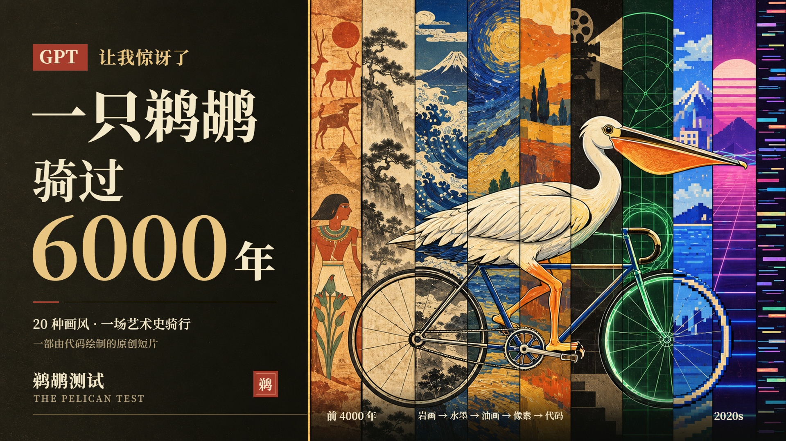
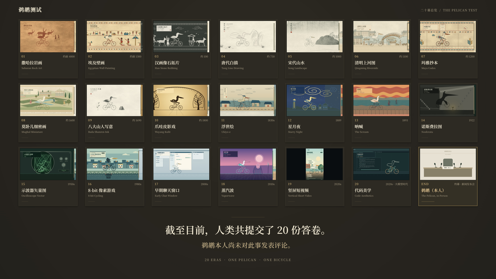

# 鹈鹕测试 · The Pelican Test

> 人类自古以来就痴迷于画鹈鹕骑自行车。——早在自行车被发明之前。



一只白鹈鹕，一辆自行车，一条连续的路。它穿过二十道画框，从撒哈拉岩画一路骑到大模型时代：世界不断更换画法，鹈鹕与自行车也随之改变模样，踩踏却始终接续。

**这是一部由代码绘制画面、由程序合成配乐的 2 分 17 秒短片。** 从砂岩上的颜料颗粒，到水墨山峦、荧光余辉与像素金币；从第一段旋律，到最后一声车铃，都在同一条时间轴上生成。

成片规格：**1920 × 1080 · 30 fps · 137 秒 · 48 kHz 立体声**，共 4,110 帧；也支持另行导出 60 fps 版本。

[本地运行](#本地运行) · [导出成片](#导出成片) · [开发与验证](#开发与验证) · [English](#english)

## 二十个时代，二十份答卷

| # | 画风 | 年代 | 旅途中发生的事 |
|---|---|---|---|
| 01 | 撒哈拉岩画 | 约公元前 4000 年 | 骑手化成赭色岩画，牧人与长角牛停步围观 |
| 02 | 埃及壁画 | 约公元前 1300 年 | 在墓室壁画里短暂停格，摆出埃及式侧身姿态 |
| 03 | 汉画像石拓片 | 约公元 100 年 | 黑底白线的骑车来客，加入车马出行的队列 |
| 04 | 唐代白描 | 约 750 年 | 一阵风掠过，羽毛与飘带一起舒展 |
| 05 | 宋代山水 | 约 1000 年 | 先看千仞山势，再推近寻找山路上的小小骑手 |
| 06 | 清明上河图 | 约 1100 年 | 骑上虹桥，沿街人物转头望向这位过客 |
| 07 | 玛雅抄本 | 约 1200 年 | 点与横组成的数字，在折页账册上记下踩踏圈数 |
| 08 | 莫卧儿细密画 | 约 1600 年 | 穿过宫廷花园，迎来宾客从不同方向投来的目光 |
| 09 | 八大山人写意 | 约 1690 年 | 留白与寥寥墨笔之间，鹈鹕翻了一个白眼 |
| 10 | 爪哇皮影戏 | 约 1800 年 | 镂空皮影与操纵杆以顿挫的节奏前进 |
| 11 | 浮世绘 | 1830 年代 | 经过富士山下的海岸驿道，风线掠过，旅人回望 |
| 12 | 星月夜 | 1889 年 | 车轮继续转动，星群与夜空的漩涡也旋转起来 |
| 13 | 呐喊 | 1893 年 | 桥上的惊呼得到鹈鹕的回应，随后留下短暂沉默 |
| 14 | 诺斯费拉图 | 1922 年 | 墙上长影自行攀上楼梯，离场时化作通电的轮廓 |
| 15 | 示波器矢量图 | 1950 年代 | 旋钮错转，荧光骑手扭成李萨如曲线 |
| 16 | 8-bit 像素游戏 | 1980 年代 | 跃过坑洞、拾取金币，跳出一枚 1UP 提示 |
| 17 | 早期聊天窗口 | 2000 年代 | 骑行进入虚构聊天软件，消息与窗口抖动接连出现 |
| 18 | 蒸汽波 | 2010 年代 | 日落、网格与胸像之间，世界随磁带减速、跳针再恢复 |
| 19 | 竖屏短视频 | 2020 年代 | 画幅收成 9:16，定格与慢放伴随点赞、评论涌入 |
| 20 | 代码美学 | 2020 年代 · 大模型时代 | SVG 路径逐行展开，把同一副骑行姿态重新画出来 |

旅程结束，二十幕汇成一面展墙。第二十一格没有新画风，只有一场等待主角出席的新闻发布会。



> 截至目前，人类共提交了 20 份答卷。鹈鹕本人对此尚未发表评论。


## 它是怎么做出来的

- **二十幕都由代码绘制。** 使用 [p5.js](https://p5js.org/)、[p5.brush](https://github.com/acamposuribe/p5.brush) 与 Canvas，将固定种子的噪声、笔触和几何组合成不同材质与画风。影片画面不依赖外部图片或视频素材。
- **给定时间，就能重建画面。** 场景由时间与固定种子驱动，不依赖上一帧。可以暂停、任意跳转，也可以逐帧导出；同一浏览器实例内，重复绘制要求逐像素一致。
- **共用动作，各自作画。** 鹈鹕与自行车共享一套骨骼姿态，二十幕分别解释这套姿态。道路、画框和镜头由合成器统一安排，让跨框时的踩踏与轮胎接地点保持连续。
- **同一旋律，二十种配器。** 原创配乐《一条路的二十种回声》以 120 BPM 的 D 小调主题贯穿全片。Web Audio 使用加法合成、FM 与固定种子噪声生成音色和音效，不使用录音或外部采样；蒸汽波的磁带变速与跳针和画面共享事件参数。
- **历史画风中的原创场景。** 每幕有独立美术简报与构图；聊天窗口和短视频界面均为虚构设计。具体绘制接口见 [架构说明](docs/ARCHITECTURE.md)，配乐设计见 [音频说明](audio/README.md)。

## 本地运行

需要以下环境：

- **Node.js 22.12+**，推荐 24 LTS。
- **Google Chrome**；非默认安装位置可用 `CHROME_PATH` 指定可执行文件。
- **ffmpeg / ffprobe**，加入 `PATH`，用于环境检查、视频编码和成片验证；编码工具还支持 `FFMPEG_PATH`。

依赖版本由锁文件固定，中文字体随项目依赖提供，npm 缓存位于 `.cache/npm/`。

```powershell
npm ci
npm run doctor
npm run dev
```

打开 <http://127.0.0.1:5173>，在浏览器中实时观看整部短片。预览默认暂停，首次播放会准备合成音色；播放时由音频时钟驱动画面。

| 操作 | 功能 |
|---|---|
| 空格 | 播放 / 暂停 |
| 左右方向键 | 前后移动 0.5 秒 |
| M | 静音 / 开声 |
| 进度条、年代按钮、下拉列表 | 跳转到指定时间或场景 |
| 全屏、截图按钮 | 放大观看或保存当前画面 |

在地址后添加 `?t=32.15` 可直接查看宋代山水中的骑手；`?export=1&t=32.15` 隐藏界面并固定为 1920 × 1080。实时预览的流畅度取决于机器性能，导出视频按固定帧率生成。

## 导出成片

安装依赖并通过环境检查后，运行完整交付流程：

```powershell
npm run demo:final
```

该命令执行测试、语法检查与生产构建，按需生成同版本音轨和视觉验收记录，然后渲染全部帧、编码 H.264/AAC MP4，检查完整解码、关键音画同步，并验证生产播放器。

| 产物 | 位置 |
|---|---|
| 完整有声成片 | `out/final/pelican-test.mp4` |
| 可通过 HTTP 服务预览的浏览器版本 | `out/final/browser/` |
| 二十幕关键帧、边界表与布局验收 | `out/final/review/` |
| 生产播放器截图、音画同步接触表 | `out/final/browser-preview.png`、`out/final/sync-sheet.png` |
| 源码指纹、文件校验与验证记录 | `out/final/delivery.json`、`out/final/export-verification.json`、`out/final/frame-verification.json` |
| 可恢复的完整逐帧 PNG | `frames/final-30/` |

完整渲染会产生 4,110 张 1080p PNG，请预留磁盘空间与渲染时间。`out/`、`frames/` 等生成目录由 Git 忽略，需在本地生成。

<details>
<summary>断点恢复、复验与生产预览</summary>

中断后复用同版本帧并重新编码：

```powershell
npm run demo:final -- --resume --overwrite
```

已有成片及配套帧、音轨、验收记录时，仅重新验证：

```powershell
npm run demo:final -- --verify-only
```

恢复要求源码指纹一致。源码改变后，使用新的帧目录，例如 `npm run demo:final -- --tag final-v2`；不要混用不同版本的画面和音乐。可加 `--fps 60` 导出 8,220 帧版本，正式交付默认采用 30 fps。

预览生产构建：

```powershell
npm run build
npm run preview
```

打开 <http://127.0.0.1:4173>。已生成完整交付目录时，也可直接运行：

```powershell
npm run preview -- --outDir out/final/browser
```

浏览器版本需通过本地 HTTP 服务访问，不能直接双击 `index.html`。

</details>

## 开发与验证

```powershell
npm test
npm run check
npm run build
npm run smoke
```

这些检查覆盖时间边界与踩踏约束、模块语法、生产构建，以及无头 Chrome 中的二十幕、中文字体、p5.brush 笔触、随机跳转确定性、播放控制与移动端布局。`smoke` 生成 `out/preview.png` 与 `out/verification/smoke.json`。

完整视觉验收使用 `npm run review:final`，音频验收使用 `npm run review:audio`。同一浏览器实例内要求逐像素一致；跨实例允许严格限值内的色阶舍入差异，阈值与实际结果记录于 [验收记录](docs/STATUS.md)。

<details>
<summary>截图、接触表与分段渲染</summary>

```powershell
npm run shot -- --time 32.15 --out out/song.png
npm run sheet -- --out out/contact-sheet.png
npm run sheet -- --times "10.9,11,11.1,88.9,89,89.1,126.5,133,136.9" --cols 3 --out out/boundaries.png

npm run render -- --fps 30 --from 9 --to 13 --out frames/motion-30
npm run encode -- --frames frames/motion-30 --out out/motion-30.mp4

npm run audio:samples
npm run audio:render
```

时间单位为秒，范围采用半开区间 `[from, to)`，帧名使用全片绝对帧号。上述渲染生成 9–13 秒的 120 帧无声片段；编码时加 `--audio out/audio/mix.wav` 可从全片音轨对应位置截取声音。

逐帧渲染支持以相同参数添加 `--resume` 续跑；编码默认不覆盖已有视频，需显式添加 `--overwrite`。完整工具参数见 `tools/`，历史分批验收与样片命令见 [阶段记录](docs/STATUS.md)。

浏览器自动化等待 `window.pelican.ready` 后，可用 `window.pelican.renderAt(t)` 绘制指定时刻。

</details>

<details>
<summary>项目目录与文档</summary>

```text
src/beat/      节拍、时间轴、场景定位与音画事件
src/kit/       绘图、材质、固定随机数与 p5.brush 适配
src/rig/       鹈鹕与自行车的共享骨骼、踩踏姿态
src/scenes/    二十幕独立场景与画风
src/main/      播放器、合成器、道路、镜头、序幕与尾声
audio/         原创乐谱、音色合成、Web Audio 调度与 WAV 编码
tools/         环境检查、截图、接触表、渲染、编码与验证
test/          时间轴、动作及导出等自动化测试
briefs/        各幕美术简报
image/         README 使用的封面、展墙与空席位图片
public/        静态资源与第三方许可文本
docs/          架构说明与验收记录
```

- [架构与接口](docs/ARCHITECTURE.md)
- [原创乐谱与音频实现](audio/README.md)
- [美术简报](briefs/README.md)
- [创作计划](PLAN.md)
- [阶段状态与验证记录](docs/STATUS.md)
- [仓库协作约定](AGENTS.md)

</details>

## 参考与致谢

本 README 的作品介绍与展示结构参考 [RoyceBella-commits / The-Pelican-Test](https://github.com/RoyceBella-commits/The-Pelican-Test)，配图使用本项目 `image/` 中提供的文件。运行命令、环境要求与成片规格均按本项目实现编写。

本项目的制作方法参考 **Tunai-0511** 的 [《67：一部藝術史》](https://github.com/Tunai-0511/meme67-art-history)：共享绘图工具、逐幕场景文件、按时间逐帧渲染、无头浏览器截帧与接触表自查。本项目独立编写，未引入该项目的源码或媒体素材，相关阅读记录见 [PLAN.md](PLAN.md)。

感谢 p5.js、p5.brush（Alejandro Campos Uribe）、Noto Serif SC 及相关开源工具的作者，也感谢为这些场景提供灵感的艺术作品与传统。

## 来源与许可

本项目尚未为自身源码与成片选择对外发布许可。第三方代码、字体、来源及适用许可见 [THIRD_PARTY_NOTICES.md](THIRD_PARTY_NOTICES.md)，原始许可文本保留在 `public/licenses/` 中，并随浏览器构建分发。`package.json` 中的 `private: true` 用于防止误发布 npm 包。

## English

**The Pelican Test** is a 2:17 short film about a white pelican cycling along one continuous road through twenty eras of art. Each frame crossing changes the world's visual language and the rider's appearance: rock art, ink landscapes, woodblock prints, swirling night skies, silent-film shadows, glowing vectors, pixels, chat windows, vaporwave, vertical video and, finally, SVG code.

The journey ends at a gallery wall with twenty paintings and one empty press-conference seat. Humankind has submitted twenty answers. The pelican has yet to comment.

The film's visuals are drawn with p5.js, p5.brush and Canvas; its original score and sound effects are synthesised with Web Audio. A shared rig keeps the pedalling continuous across styles, while time and seeded randomness make frames reproducible. The default export is **1920 × 1080, 30 fps, 137 seconds, with 48 kHz stereo audio**.

To run locally, install **Node.js 22.12+** (24 LTS recommended), **Google Chrome**, and **ffmpeg / ffprobe** on your `PATH`. Run `npm ci`, `npm run doctor`, then `npm run dev` and open <http://127.0.0.1:5173>. Press Space to play or pause. Run `npm run demo:final` to generate the full film at `out/final/pelican-test.mp4` and a browser build at `out/final/browser/`.

This README's presentation draws on [RoyceBella-commits / The-Pelican-Test](https://github.com/RoyceBella-commits/The-Pelican-Test). The production workflow was inspired by [Tunai-0511 / meme67-art-history](https://github.com/Tunai-0511/meme67-art-history). Thanks to their authors and the open-source tools used here. This project has not yet selected a public license for its own code or film; third-party terms are listed in [THIRD_PARTY_NOTICES.md](THIRD_PARTY_NOTICES.md).
